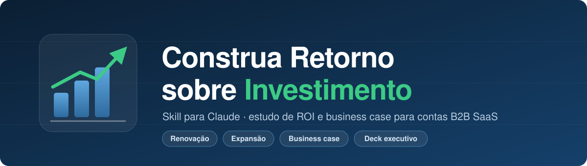
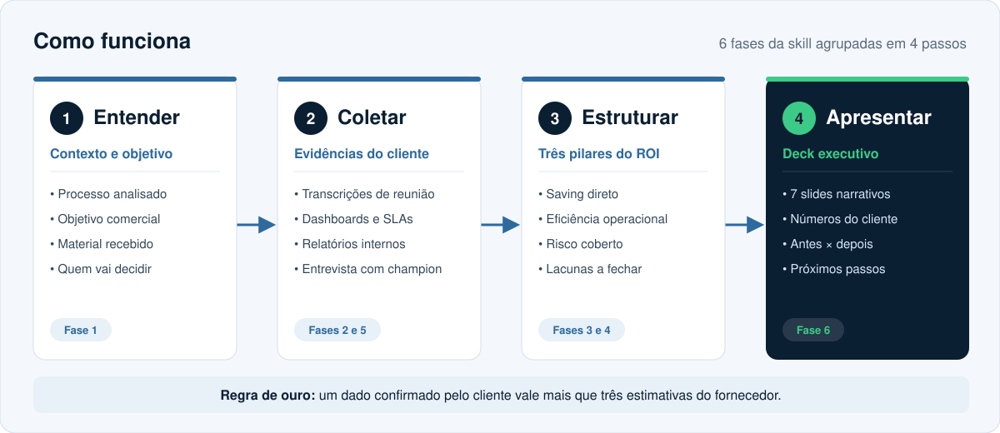
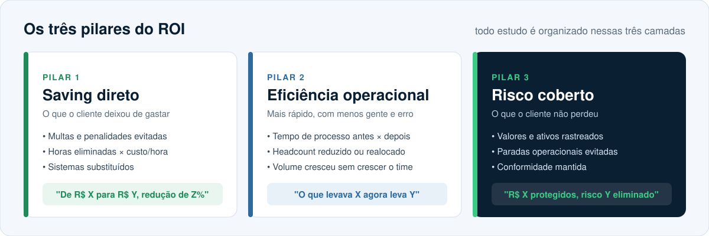

<p align="center">
  
</p>

<p align="center">
  
  
  
</p>

# Construa Retorno sobre Investimento

Uma skill para o Claude que transforma transcrições de reunião, dashboards e relatórios do cliente em um **estudo de ROI defensável** e um **deck executivo de 7 slides**, pronto para a conversa de renovação ou expansão.

Feita para Account Executives, Customer Success e times de Value Engineering de empresas B2B SaaS que precisam provar valor com os números do próprio cliente, e não com estimativas do fornecedor.

---

## Por que usar

A maioria dos estudos de ROI falha por um de três motivos: números estimados pelo fornecedor, que o cliente não reconhece; dados soltos, sem uma narrativa que a diretoria entenda; e lacunas descobertas tarde demais, já na reunião.

Esta skill ataca os três:

- **Extrai evidência** de material que você já tem (transcrições, PPTs de indicadores, planilhas, relatórios internos).
- **Separa o que é confirmado do que é estimativa**, sempre de forma explícita.
- **Aponta as lacunas** antes da apresentação e gera as perguntas certas para fechá-las com o champion.
- **Organiza tudo em três pilares** e numa sequência de slides que a diretoria lê em poucos minutos.

---

## Como funciona

<p align="center">
  
</p>

A skill tem 6 fases, agrupadas aqui em 4 passos:

| Passo | O que acontece | Fases da skill |
|---|---|---|
| **1. Entender** | Define o processo analisado, o objetivo comercial (renovação, upsell, expansão ou case) e quem vai receber o estudo | Fase 1 |
| **2. Coletar** | Extrai números, dores do antes, ganhos e casos concretos de transcrições, dashboards e relatórios; prepara o roteiro de entrevista com o champion | Fases 2 e 5 |
| **3. Estruturar** | Organiza o ROI nos três pilares e classifica as lacunas em críticas, importantes e residuais | Fases 3 e 4 |
| **4. Apresentar** | Monta o deck executivo de 7 slides com copy sugerida e checklist de qualidade | Fase 6 |

---

## Os três pilares

<p align="center">
  
</p>

O pilar de risco coberto costuma ser o mais subestimado. Milhões em valores rastreados impressionam mais que dezenas de milhares economizados. Use os três, mas abra com o maior.

---

## O deck de 7 slides

| # | Slide | Mensagem |
|---|---|---|
| 1 | Capa | Processo, empresa, período e 3 números âncora |
| 2 | O que está em jogo | Volume financeiro sob gestão e por que importa |
| 3 | Saving direto | Antes × depois, com a % de redução no subtítulo |
| 4 | Ganho de SLA | Série histórica por unidade, com a meta interna do cliente |
| 5 | Eficiência operacional | Tempo, pessoas e volume crescendo com SLA melhor |
| 6 | Controle e visibilidade | Checklist antes × depois, caso real e citação do champion |
| 7 | ROI consolidado | Os três pilares e o próximo passo concreto |

O copy sugerido para cada slide está em [`references/roi-template.md`](references/roi-template.md). Para gerar o arquivo `.pptx`, a skill se apoia na skill `pptx` do Claude.

---

## Estrutura do repositório

```
roi-study-enterprise/
├── SKILL.md                         # instruções principais da skill
├── references/
│   ├── roi-template.md              # copy sugerida para os 7 slides + checklist
│   └── interview-questions.md       # banco de perguntas por tipo de processo
└── assets/                          # imagens deste README
```

---

## Instalação

**Claude (app e web)**

1. Baixe este repositório como `.zip` (botão **Code → Download ZIP**).
2. Confirme que o `.zip` contém a pasta `roi-study-enterprise` com o `SKILL.md` na raiz dela.
3. Envie o arquivo na área de **Skills** das configurações do Claude.

**Claude Code**

```bash
git clone https://github.com/iyitrade25-hub/roi-study-enterprise.git \
  ~/.claude/skills/roi-study-enterprise
```

A pasta `assets/` serve só para este README e pode ser removida da instalação, se preferir.

---

## Exemplos de uso

Depois de instalada, a skill é acionada sozinha quando o assunto é ROI, business case, renovação ou expansão. Alguns pedidos que funcionam bem:

> "Segue a transcrição da reunião com o champion. Extraia as evidências de ROI e me diga o que ainda falta."

> "Vou ter uma reunião de ROI amanhã com o gestor de compras. Monte o roteiro de perguntas."

> "Com esses indicadores de SLA de 2 anos, monte o deck executivo de renovação."

> "Separe o que é dado confirmado e o que é estimativa neste resumo."

---

## Exemplo ilustrativo

O `SKILL.md` traz um caso **fictício** (uma distribuidora com processo de compras) para mostrar o formato esperado de saída. Empresa e números são inventados e não representam nenhum cliente real.

---

## Princípios da skill

- **Números do cliente primeiro.** Dados validados pelo próprio cliente valem mais que qualquer estimativa do fornecedor.
- **Documentado ≠ estimado.** Os dois nunca aparecem misturados sem sinalização.
- **Curva de maturidade.** A evolução ao longo de dois ou três períodos é mais difícil de refutar que uma foto do momento.
- **Outliers explicados antes da pergunta.** Exceções vêm com causa raiz, o que reforça a credibilidade.

---

## Contribuindo

Sugestões de novas perguntas, novos tipos de processo ou melhorias no template são bem-vindas. Abra uma *issue* ou envie um *pull request*.

**Nunca inclua dados reais de clientes** em exemplos, issues ou pull requests. Use apenas casos fictícios.

---

## Licença

Distribuída sob a licença MIT. Veja [`LICENSE`](LICENSE).
